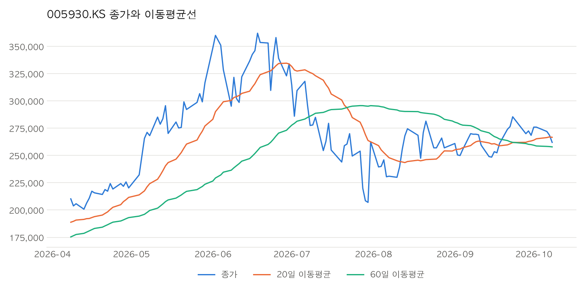

# stock-viewer

종목 코드를 입력하면 최근 종가, 기간 등락률, 이동평균선 차트를 보여주는 간단한 주가 조회기입니다.
Python과 Git/GitHub를 익히기 위한 첫 프로젝트입니다.

## 실행 방법

```bash
python3 -m venv .venv
source .venv/bin/activate
pip install -r requirements.txt

python main.py AAPL           # 애플 최근 5거래일
python main.py 005930.KS 10   # 삼성전자(코스피) 최근 10거래일
python main.py                            # 인자 없이 실행하면 질문을 받음
python main.py 005930.KS --chart              # 차트 저장 (charts/005930.KS.png)
python main.py AAPL --chart --months 12       # 최근 12개월 차트
```

종목 코드 형식: 미국은 `AAPL`, 코스피는 `005930.KS`, 코스닥은 `035720.KQ`

## 출력 예시

```
[AAPL] 최근 5거래일 종가
  2026-10-05  332.89
  ...
기간 등락률: +1.13%
```

## 차트 예시 (삼성전자, 종가 + 20일/60일 이동평균선)



> 이동평균선은 최근 N거래일 종가의 평균입니다. 종가가 이동평균선 위에 있으면 최근 평균보다 비싸게 거래되고 있다는 뜻입니다.

## 사용 기술
- Python 3
- [yfinance](https://github.com/ranaroussi/yfinance) (Yahoo Finance 데이터)
- pandas (이동평균 계산), matplotlib (차트)

## 다음 계획
- [x] 이동평균선 계산
- [x] 차트 그리기 (matplotlib)
- [x] 입력(input)으로 종목 코드 받기
- [ ] 여러 종목 한 번에 조회
- [ ] 골든크로스/데드크로스 표시
